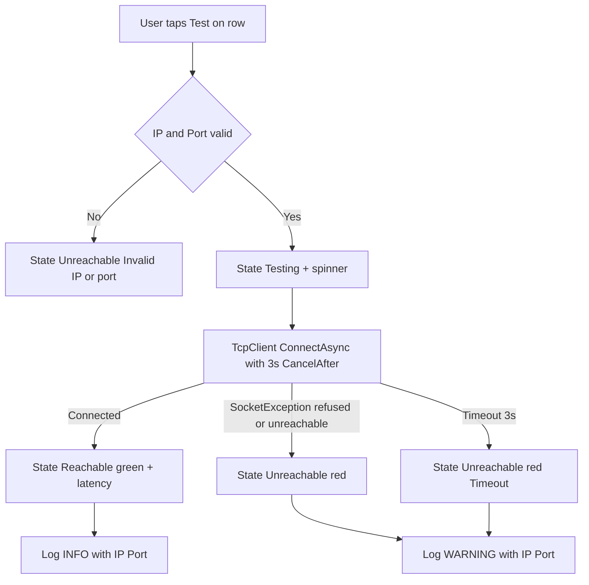

# Plan — "Test" button for HL7v2 (MLLP) endpoints in the Connections list

> Scope: analysis + design only. NO code written. This is the actionable plan for the follow-up code phase.

## 1. Current state (verified by reading the source)

### 1.1 The "endpoints HL7V2" list = Connection History
There is **no** separate "endpoints" collection. The HL7v2 (MLLP/TCP) endpoints shown to the user are the **Saved Connections** list inside the *Connection History* card in [`ConnectionsPage.xaml`](V2/HL7Tester/ConnectionsPage.xaml:72).

- `CollectionView ItemsSource="{Binding HistoryEntries}"` ([`ConnectionsPage.xaml:86`](V2/HL7Tester/ConnectionsPage.xaml:86)), `HeightRequest="240"`.
- Row `DataTemplate` ([`ConnectionsPage.xaml:92-113`](V2/HL7Tester/ConnectionsPage.xaml:92)):
  - `Border` with style `ClickableListItemBorder`, a `TapGestureRecognizer` → `SelectHistoryEntryCommand` (param = `DisplayText`).
  - Inner `Grid ColumnDefinitions="*,Auto" ColumnSpacing="8"`:
    - **Column 0** = `Label Text="{Binding DisplayText}"` (IP:Port (Nickname)).
    - **Column 1** = delete `Button Text="🗑️"` → `DeleteHistoryEntryCommand` (param = `{Binding .}`, the row VM).
- **Insertion point for the "Test" button**: the same inner grid, as a new `Auto` column before the delete button → `ColumnDefinitions="*,Auto,Auto"`.

### 1.2 Row model = `HistoryEntryViewModel`
Defined nested in [`ConnectionsViewModel.cs:720-724`](V2/HL7Tester/ViewModels/ConnectionsViewModel.cs:720):
```csharp
public sealed class HistoryEntryViewModel
{
    public string DisplayText { get; set; } = string.Empty;
    public ConnectionHistoryEntry? Entry { get; set; }
}
```
- Built in `RefreshHistory()` ([`ConnectionsViewModel.cs:604-617`](V2/HL7Tester/ViewModels/ConnectionsViewModel.cs:604)).
- ⚠️ It currently does **NOT** implement `INotifyPropertyChanged`. For live status updates (Testing → Reachable/Unreachable) it **must** implement it.
- `ConnectionHistoryEntry` ([`NetworkSettings.cs:74-79`](V2/HL7Tester.Core/NetworkSettings.cs:74)) holds `Ip`, `Port`, `Nickname` — these are the values to test.

### 1.3 How MLLP/TCP connectivity works today
[`Hl7NetworkSender.SendAsync`](V2/HL7Tester.Core/Hl7NetworkSender.cs:56) opens a `TcpClient`, calls `client.ConnectAsync(ip, port, ct)`, frames `<VT>msg<FS><CR>`, writes, then best-effort reads an ACK (3 s read timeout). `SenderRouter` ([`SenderRouter.cs`](V2/HL7Tester.Core/Sending/SenderRouter.cs)) dispatches MLLP vs FHIR. The raw `ConnectAsync` is exactly the primitive we need for a reachability probe — no message needed.

### 1.4 Converters & DI
- Existing converters in [`Resources/Converters/`](V2/HL7Tester/Resources/Converters/): `BoolToVisibilityConverter`, `BoolToArrowConverter`, `CollectionNotEmptyConverter`, `StringNotEmptyConverter`, `NodeLevelToColorConverter`, `ProtocolDisplayConverter`. `NodeLevelToColorConverter` is the **template to copy** for a status→color converter.
- DI in [`MauiProgram.cs:80-81`](V2/HL7Tester/MauiProgram.cs:80): `ConnectionsViewModel`/`ConnectionsPage` are `AddTransient`. `IHL7NetworkSender` is a singleton ([`MauiProgram.cs:58`](V2/HL7Tester/MauiProgram.cs:58)).

---

## 2. Recommended test method — TCP connect with timeout

**Recommendation: plain TCP connection probe (3-way handshake) with a timeout. Do NOT send an HL7 message / do NOT do a full MLLP handshake.**

| Option | Pros | Cons | Verdict |
|--------|------|------|---------|
| **A. TCP connect only** (`TcpClient.ConnectAsync`) | No side effects on receiver; fast; proves the listener accepts connections; matches "endpoint reachable" semantics | Doesn't prove the HL7 app layer responds | ✅ **Recommended** |
| B. MLLP handshake (send MSH, wait ACK) | Proves full app-layer health | **Creates a real message on the receiver** (logged/persisted), needs a valid ControlID, slower, can trigger receiver business logic / duplicate-ID errors | ❌ Avoid as default |
| C. TCP connect + optional MLLP ping | Best of both | More complex; still side-effect risk | Optional, behind a flag |

**Rationale**: The user asked "has the endpoint been reached / reachable". A successful TCP connect is the precise, side-effect-free answer for an MLLP/TCP endpoint. Sending a real ACK-triggering message would pollute production HL7 receivers — unacceptable as a passive "test".

**Timeout: 3 seconds** (consistent with the existing 3 s ACK read timeout in `Hl7NetworkSender`). Implement via `CancellationTokenSource.CancelAfter(3000)` around `ConnectAsync`. Treat `SocketException` (refused / host unreachable) and `OperationCanceledException` (timeout) both as **Unreachable**.

> **Decision to confirm with user (see §6):** is a passive TCP probe enough, or do you want an optional "deep" MLLP ping?

---

## 3. Implementation plan

### 3.1 New service: `EndpointProbe` (Core, protocol-agnostic, testable)
New file `V2/HL7Tester.Core/EndpointProbe.cs` (or under `Sending/`).

```csharp
public interface IEndpointProbe
{
    Task<EndpointProbeResult> TestTcpAsync(string ip, int port, int timeoutMs = 3000, CancellationToken ct = default);
}

public sealed record EndpointProbeResult
{
    public bool Reachable { get; init; }
    public string Message { get; init; } = string.Empty; // human-readable, English
    public TimeSpan Latency { get; init; }               // optional, nice UX
}
```
Implementation uses `TcpClient` + `ConnectAsync` + `CancelAfter`. Wrap `SocketException`/`OperationCanceledException`/`Exception` into `Reachable=false` with a clear `Message`. Register in DI as a **singleton** alongside `IHL7NetworkSender`.

> This keeps the ViewModel thin and unit-testable (mirrors how `BatchSendEngineTests` tests the engine).

### 3.2 Row model: `HistoryEntryViewModel` gains status + command
Modify `HistoryEntryViewModel` in [`ConnectionsViewModel.cs`](V2/HL7Tester/ViewModels/ConnectionsViewModel.cs:720):
- Implement `INotifyPropertyChanged` (copy the `SetField` pattern from the parent VM).
- Add an enum `EndpointTestState { Unknown, Testing, Reachable, Unreachable }`.
- Add properties:
  - `EndpointTestState State` (default `Unknown`)
  - `string StatusText` → "—", "Testing…", "Reachable", "Unreachable"
  - `bool IsBusy` (drives `IsRunning`/disable on the button)
  - `Color StatusColor` → computed from `State` (indigo/gray, gray, green, red) OR expose `State` and let a converter map to color (preferred — see 3.4).
- Add `ICommand TestCommand` wired in the parent VM (see 3.3) that:
  1. Sets `State = Testing`, raises PropertyChanged.
  2. Parses `Entry.Ip` / `Entry.Port` (`int.TryParse`; invalid port → `Unreachable` with "Invalid port").
  3. Calls `IEndpointProbe.TestTcpAsync(ip, port, 3000)`.
  4. Sets `State = Reachable/Unreachable`, `StatusText`, `StatusColor`.
  5. Logs via `ILogger` (INFO on reachable, WARNING on unreachable).

> **Design choice:** put the command on the **row VM** (not a single VM-level `TestEndpointCommand`), because the row already owns `Entry` (Ip/Port) and per-row status. This matches the existing per-row `DeleteHistoryEntryCommand` pattern and avoids `CommandParameter` juggling. Inject `IEndpointProbe` + `ILogger` into the row VM factory (see 3.3).

### 3.3 ViewModel wiring in `ConnectionsViewModel`
- Inject `IEndpointProbe endpointProbe` into the `ConnectionsViewModel` constructor ([`ConnectionsViewModel.cs:358`](V2/HL7Tester/ViewModels/ConnectionsViewModel.cs:358)).
- In `RefreshHistory()` ([`ConnectionsViewModel.cs:614`](V2/HL7Tester/ViewModels/ConnectionsViewModel.cs:614)), when constructing each `HistoryEntryViewModel`, pass `endpointProbe` + `_logger` and wire `TestCommand = new Command(...)` (or a small helper `CreateTestCommand(entryVm)`).
- Guard: disable the Test button when `Entry.Ip`/`Port` are blank.

### 3.4 New converter: `EndpointStatusToColorConverter`
New file `V2/HL7Tester/Resources/Converters/EndpointStatusToColorConverter.cs` — `IValueConverter` mapping `EndpointTestState` → `Color`:
- `Unknown` → `Gray400`/`Gray500` (AppThemeBinding-aware, or just Gray)
- `Testing` → `Gray500`
- `Reachable` → green `#2E7D32` / `Color.FromArgb("#4CAF50")`
- `Unreachable` → red `#C62828` / `Color.FromArgb("#F44336")`

Use the same pattern as [`NodeLevelToColorConverter.cs`](V2/HL7Tester/Resources/Converters/NodeLevelToColorConverter.cs). Declare it in `App.xaml` resources (or page resources) next to the other converters.

> Alternative (no converter): expose a precomputed `Color StatusColor` on the row VM and bind directly. Either works; converter keeps color logic in one reusable place. **Recommend converter** for consistency with `NodeLevelToColorConverter`.

### 3.5 XAML changes — [`ConnectionsPage.xaml`](V2/HL7Tester/ConnectionsPage.xaml:92)
Inside the History `DataTemplate` inner grid:
- Change to `ColumnDefinitions="*,Auto,Auto" ColumnSpacing="8"`.
- **Column 1** = new status indicator + Test button. Suggested: a small `HorizontalStackLayout` (or a `Grid`) containing:
  - A status dot: `Border` (width/height ~10, `CornerRadius=5`, `BackgroundColor="{Binding State, Converter={StaticResource EndpointStatusToColorConverter}}"`) — **or** a colored `Label` with the status text.
  - A `Button Text="Test"` (compact: `FontSize="12" Padding="8,2"`, `BackgroundColor="Transparent"` like the delete button), `Command="{Binding TestCommand}"`, `IsEnabled="{Binding NotBusy}"` (or bind to `!IsBusy`), and optional `ActivityIndicator IsRunning="{Binding IsBusy}"` for the in-progress state.
  - Optional status `Label Text="{Binding StatusText}"` `TextColor="{Binding State, Converter=...}"` `FontSize="12"`.
- **Column 2** = the existing 🗑️ delete button (move it from Column 1 to Column 2).
- Keep the row `TapGestureRecognizer` (select entry) intact; ensure the new button's tap doesn't bubble into selection (MAUI `Button` consumes the tap, so this is safe, same as the delete button today).

> **Theme**: use `AppThemeBinding` or fixed semantic colors; green/red are readable in both themes.

### 3.6 Async / busy handling
- `TestCommand` is an `async` `Command` (project already uses `new Command(async () => ...)`).
- Row-level `IsBusy` guards re-entry and shows the spinner; button disabled while testing.
- No page-level busy needed (per-row).

### 3.7 Errors / timeout
- Timeout via `CancelAfter(3000)` → `OperationCanceledException` ⇒ `Unreachable`, message "Timeout after 3s".
- `SocketException` ⇒ `Unreachable`, message from `ex.Message` (e.g. "Connection refused").
- Invalid IP/port ⇒ `Unreachable`, "Invalid IP or port".
- All failures logged as `WARNING`/`ERROR` with IP:Port context (matches existing logging style).

---

## 4. Files to modify / create

| File | Change |
|------|--------|
| `V2/HL7Tester.Core/EndpointProbe.cs` | **NEW** — `IEndpointProbe` + `EndpointProbeResult` + TCP-probe impl (English strings/comments) |
| `V2/HL7Tester/MauiProgram.cs` | Register `IEndpointProbe` as singleton (near line 58) |
| `V2/HL7Tester/ViewModels/ConnectionsViewModel.cs` | Inject `IEndpointProbe`; `HistoryEntryViewModel` → `INotifyPropertyChanged` + `EndpointTestState`/`StatusText`/`IsBusy`/`TestCommand`; wire command in `RefreshHistory()` |
| `V2/HL7Tester/Resources/Converters/EndpointStatusToColorConverter.cs` | **NEW** — `EndpointTestState` → `Color` |
| `V2/HL7Tester/App.xaml` (or page resources) | Declare the new converter resource |
| `V2/HL7Tester/ConnectionsPage.xaml` | History row grid `*,Auto` → `*,Auto,Auto`; add status dot/label + "Test" button; move delete button to last column |
| `V2/HL7Tester.Tests/EndpointProbeTests.cs` | **NEW (recommended)** — unit tests: reachable (against a local `TcpListener`), refused, timeout, invalid port |
| `V2/HL7Tester.csproj` + `Platforms/Windows/app.manifest` + `Package.appxmanifest` | Version bump (follow project convention) |
| `V2/HL7Tester/Resources/Raw/whatsnew.md` | End-user announcement card (emoji title, `>` tagline, benefit bullets — per ARCHITECTURE.md guidelines) |

---

## 5. Mermaid — test flow



---

## 6. Decisions to confirm with the user

1. **Probe depth**: passive TCP connect (recommended) vs optional "deep" MLLP ping (sends a real message → side effects on the receiver). Default = TCP only.
2. **Timeout**: 3 s (recommended, matches existing ACK timeout) vs configurable.
3. **Status persistence**: ephemeral (per session, resets on reload — recommended) vs persisted in `networksettings.json` (`LastTestResult`/`LastTestTime`). Recommended ephemeral: reachability is transient; persisting stale results can mislead.
4. **Status display style**: colored dot only / dot + text / colored text label. Recommended: dot + short text.
5. **Location**: confirmed on the Saved Connections (history) rows. (If the user also wants it on the FHIR Profiles list, that's a separate FHIR-HTTP probe — out of scope here.)
