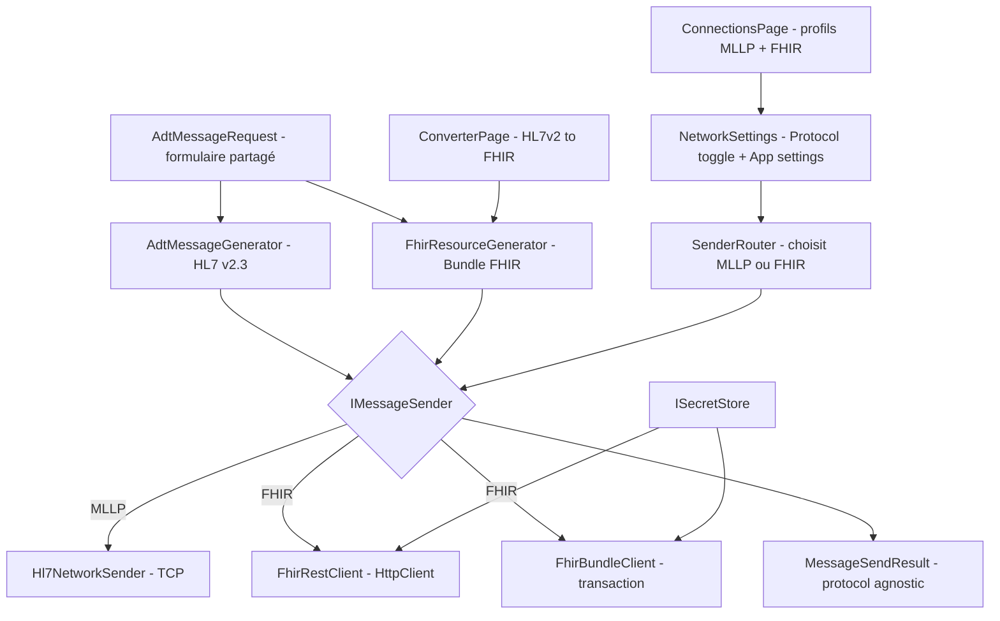
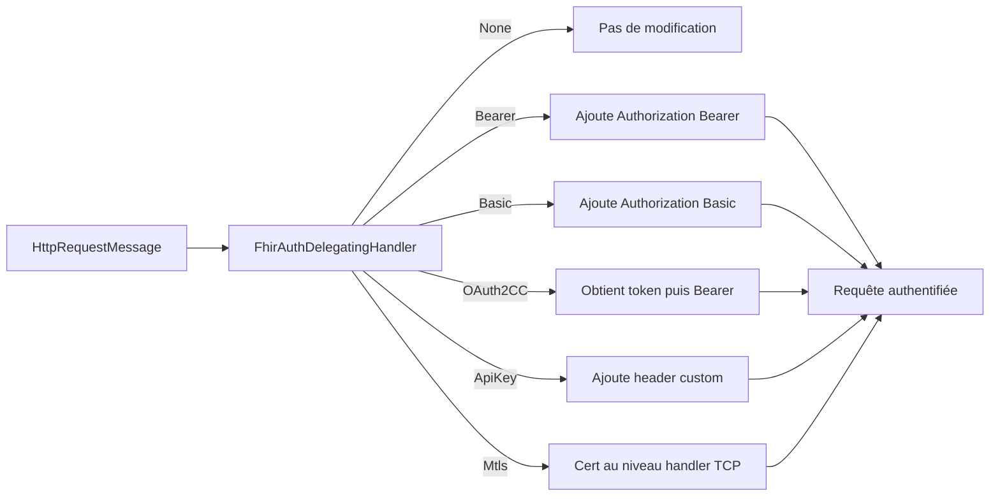
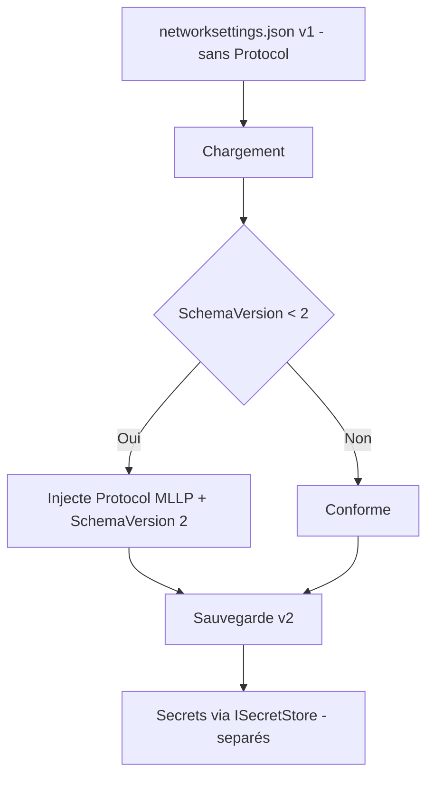
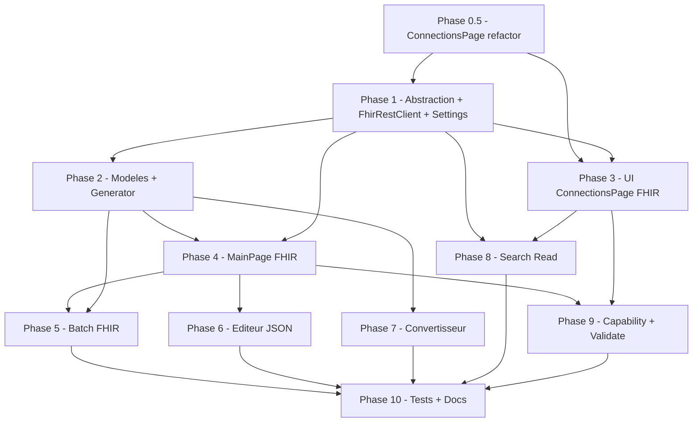

# Module FHIR — Document de design

> **Statut** : conception validée — décisions D1–D10 tranchées. Prêt pour l'implémentation (Phase 0.5 en premier).
> **Objectif** : permettre à HL7Tester de fonctionner aussi bien en **HL7 v2 / MLLP** (existant) qu'en **FHIR / REST** (nouveau), avec un socle partagé (génération, envoi, batch, settings, secrets).
> **Public** : développeur qui implémentera chaque phase sans ambiguïté.
> **Langue du document** : français. Tous les identifiants de code, classes, fichiers et namespaces sont en **anglais** (conformément à la politique *ENGLISH ONLY* du projet).

---

## 0. État des lieux & principes directeurs

### 0.1 Ce qui existe déjà (ancrage réel)

| Composant | Fichier | Rôle actuel |
|-----------|---------|-------------|
| Sender réseau | [`HL7Tester.Core/Hl7NetworkSender.cs`](../V2/HL7Tester.Core/Hl7NetworkSender.cs:24) | `IHL7NetworkSender.SendAsync(message, ip, port, ct, encodingName, existingClient)` → `SendResult` (MLLP + parsing MSA-1) |
| Résultat d'envoi | `SendResult` dans [`Hl7NetworkSender.cs`](../V2/HL7Tester.Core/Hl7NetworkSender.cs:11) | `Success`, `MessageCode`, `AckMessage`, `MsaStatus`, `ErrorDescription`, `ErrorMessage` |
| Générateur HL7 | [`HL7Tester.Core/Class1.cs`](../V2/HL7Tester.Core/Class1.cs:96) | `AdtMessageGenerator.Generate(AdtMessageRequest)` → chaîne HL7 v2.3 (NHapi) |
| Modèle d'entrée formulaire | `AdtMessageRequest` dans [`Class1.cs`](../V2/HL7Tester.Core/Class1.cs:16) | Champs patient / localisation / ORM / SIU — **c'est le modèle canonique d'entrée** |
| Settings | [`HL7Tester.Core/NetworkSettings.cs`](../V2/HL7Tester.Core/NetworkSettings.cs:8) | JSON `networksettings.json` : IP, port, historique, encodage, log level |
| ViewModel principal | [`HL7Tester/ViewModels/MainViewModel.cs`](../V2/HL7Tester/ViewModels/MainViewModel.cs:778) | `OnGenerate()` puis `OnSendAsync()` (charge settings, normalise fins de ligne, appelle sender) |
| Moteur batch | [`HL7Tester.Core/Batch/BatchSendEngine.cs`](../V2/HL7Tester.Core/Batch/BatchSendEngine.cs:13) | Patients parallèles + throttle global + keep-connection TCP |
| DI | [`HL7Tester/MauiProgram.cs`](../V2/HL7Tester/MauiProgram.cs:56) | Enregistrements `AddSingleton` / `AddTransient` |
| Tests | [`HL7Tester.Tests/`](../V2/HL7Tester.Tests/) | MSTest |

### 0.2 Anomalie à corriger en préambule

Le projet [`HL7Tester.Core.csproj`](../V2/HL7Tester.Core/HL7Tester.Core.csproj:4) cible **`net8.0`** alors que l'app MAUI cible **`net10.0`**. **Décision D5 tranchée** : la Phase 1 aligne Core sur `net10.0` pour bénéficier d'`IHttpClientFactory`, des APIs crypto modernes, du SDK `Hl7.Fhir.R4` et d'une cohérence de compilation.

### 0.3 Principes directeurs

1. **Le formulaire existant (`AdtMessageRequest`) reste l'entrée unique.** On ne recrée pas un second formulaire FHIR au départ : on ajoute un *moteur de rendu* FHIR qui consomme le même `AdtMessageRequest`.
2. **Abstraction d'envoi protocol-agnostique.** `IHL7NetworkSender` devient une *implémentation* d'une nouvelle interface `IMessageSender`. MainPage et BatchSendEngine dépendent de l'abstraction, pas du MLLP.
3. **Rétrocompatibilité stricte.** Un `networksettings.json` existant doit se charger sans erreur ; `Protocol` absent ⇒ comportement MLLP actuel.
4. **Secrets ≠ configuration.** URLs / profils / endpoints en clair ; tokens / mots de passe / client secrets chiffrés via OS.
5. **SDK FHIR comme référence et implémentation.** Utiliser `Hl7.Fhir.R4` (Firely SDK) comme base des modèles et de la sérialisation (décision **D1**). Le SDK sert aussi de référence pour DSTU2/R5 futurs.
6. **Toggle global du protocole.** Un seul réglage MLLP/FHIR dans les settings ; toutes les pages s'adaptent (badge du mode actif). Un utilisateur est soit 100% HL7v2, soit 100% FHIR.
7. **Endpoints dans une page dédiée.** Les connexions (IP/Port pour MLLP, BaseUrl/Auth pour FHIR) sont extraites de `NetworkSettingsPage` vers `ConnectionsPage` (Phase 0.5).

### 0.4 Vue d'architecture cible



---

## 1. Interactions FHIR à supporter

FHIR est un API REST : chaque ressource est une URL, les verbes HTTP portent la sémantique. Pour un outil de test, on cible les interactions suivantes.

### 1.1 Table de référence — interactions REST

| Interaction | Méthode + endpoint | Corps de requête | Corps de réponse | Équivalent HL7 v2 |
|-------------|--------------------|------------------|------------------|-------------------|
| **Create** | `POST [base]/Patient` | JSON `Patient` | JSON `Patient` (avec `id`, `meta`) | ADT A01 / A28 (création patient) |
| **Read** | `GET [base]/Patient/{id}` | — | JSON `Patient` | — (pas d'équivalent direct en push v2) |
| **VRead** | `GET [base]/Patient/{id}/_history/{vid}` | — | JSON versionnée | — |
| **Update (full)** | `PUT [base]/Patient/{id}` | JSON `Patient` complet | JSON `Patient` | ADT A08 (update stay) / A31 (update patient) |
| **Patch (partiel)** | `PATCH [base]/Encounter/{id}` | JSON Patch ou `Parameters` | JSON `Encounter` | ADT A03 (décharge ⇒ status finished) |
| **Delete** | `DELETE [base]/Patient/{id}` | — | `OperationOutcome` ou 204 | ADT A09/A11 (annulation, sémantique approchante) |
| **Search** | `GET [base]/Patient?identifier=...` | — | JSON `Bundle` type `searchset` | — (requête ; v2 n'a pas d'équivalent standardisé) |
| **History** | `GET [base]/Patient/{id}/_history` | — | JSON `Bundle` `history` | — |
| **Transaction Bundle** | `POST [base]` | JSON `Bundle` type `transaction` | JSON `Bundle` type `transaction-response` | ADT A01 complet (multi-ressources atomiques) |
| **Batch Bundle** | `POST [base]` | JSON `Bundle` type `batch` | JSON `Bundle` type `batch-response` | Envoi groupé non atomique |
| **$validate** | `POST [base]/Patient/$validate` | JSON `Resource` ou `Parameters` | JSON `OperationOutcome` | Test de validation serveur (pas d'équivalent v2) |
| **$everything** | `GET [base]/Patient/{id}/$everything` | — | JSON `Bundle` `searchset` | Regroupement toutes données patient |
| **$merge** | `POST [base]/Patient/$merge` | JSON `Parameters` (old/new) | `OperationOutcome` / patient | ADT A40 / A18 (merge patient) |
| **$member-match** | `POST [base]/Coverage/$member-match` | JSON `Parameters` | `Bundle` candidates | — (gestion affiliations) |
| **CapabilityStatement** | `GET [base]/metadata` | — | JSON `CapabilityStatement` | — (découverte serveur) |

### 1.2 Détail par interaction

#### 1.2.1 CRUD standard

- **Headers communs** : `Content-Type: application/fhir+json`, `Accept: application/fhir+json`. Version R4 recommandée via `Accept: application/fhir+json; fhirVersion=4.0`.
- **Create** : le serveur génère `id` + `meta.versionId` + `meta.lastUpdated`. Code HTTP `201 Created` + header `Location`.
- **Update (PUT)** : idempotent si `id` dans le corps correspond à l'URL ; sinon `400`. Gérer le conflit d'optimistic locking via `If-Match: W/"version"` (à documenter en Phase 8).
- **Patch** : deux formats — JSON Patch RFC 6902 (`application/json-patch+json`) ou FHIR `Parameters`. Pour un outil de test, supporter **JSON Patch** (plus universel) et exposer un générateur de patch simple (ex. `[{ "op": "replace", "path": "/status", "value": "finished" }]`).
- **Delete** : `204 No Content` ou `OperationOutcome`.

#### 1.2.2 Transaction vs Batch Bundle

Un **Bundle** est un conteneur d'entrées (`entry[]`), chacune avec une `request` (méthode, url) et une `resource`.

| | Transaction | Batch |
|---|-------------|-------|
| `Bundle.type` | `transaction` | `batch` |
| Atomicité | Tout ou rien (rollback) | Indépendant, partiel possible |
| Ordonnancement | Le serveur peut réordonner via `ifNoneExist` | Exécuté dans l'ordre |
| Réponse | `transaction-response` | `batch-response` |
| Usage test | Simuler A01 complet (Patient + Encounter + Observation atomiques) | Stress / envoi multiple non transactionnel |

Exemple de squelette transaction (A01) — voir Section 2 pour le mapping complet.

```json
{
  "resourceType": "Bundle",
  "type": "transaction",
  "entry": [
    {
      "fullUrl": "urn:uuid:PID-REF",
      "resource": { "resourceType": "Patient", "identifier": [ ... ] },
      "request": { "method": "POST", "url": "Patient", "ifNoneExist": "identifier=..." }
    },
    {
      "resource": {
        "resourceType": "Encounter",
        "status": "in-progress",
        "class": { "system": "http://terminology.hl7.org/CodeSystem/v3-ActCode", "code": "AMB" },
        "subject": { "reference": "urn:uuid:PID-REF" }
      },
      "request": { "method": "POST", "url": "Encounter" }
    }
  ]
}
```

#### 1.2.3 Operations

- **$validate** : ne persiste rien, renvoie un `OperationOutcome` (`issue[]` avec `severity`, `code`, `details`). Idéal pour un bouton « Validate » dans l'UI.
- **$everything** : `GET /Patient/{id}/$everything` — pratique pour vérifier l'état du serveur après envoi.
- **$merge** : payload `Parameters` avec `oldPatientId` / `newPatientId` (noms de champs selon implémentation serveur — à rendre configurable, car ce n'est pas standardisé de façon unique). Mapping direct avec A40/A18 existants.
- **$member-match** : `Coverage` — hors périmètre prioritaire, à garder en Phase 9 « extension ».

#### 1.2.4 Search

`GET [base]/Patient?identifier=system|value` ou `?name=Doe&gender=female`. Réponse `Bundle` `searchset` avec `entry[].resource` + `search.mode`. Supporter les paramètres courants : `identifier`, `name`, `birthdate`, `gender`, `_id`, `_count`, `_sort`.

#### 1.2.5 CapabilityStatement

`GET [base]/metadata` → révèle `rest.resource[]` (ressources supportées, opérations, modes d'interaction), `security` (méthodes d'auth annoncées), `fhirVersion`. **Phase 9** : alimenter dynamiquement les dropdowns de l'UI (ressources disponibles, opérations supportées).

---

## 2. Mapping HL7 v2 → FHIR Resources

### 2.1 Principe de mapping

Le générateur FHIR consomme `AdtMessageRequest` (déjà peuplé par le formulaire) et produit soit une **ressource unique**, soit un **Bundle transaction**, selon le type de message. Le `MessageTypeCode` (ex. `"ADT A01 - ..."`) pilote le rendu, exactement comme dans [`AdtMessageGenerator.Generate`](../V2/HL7Tester.Core/Class1.cs:110).

### 2.2 Mapping principal (message → appel FHIR)

| HL7 v2 | Déclencheur | Appel FHIR | Ressources générées | Notes |
|--------|-------------|------------|---------------------|-------|
| **ADT A01** | Admission | `POST [base]` (Bundle transaction) | `Patient` + `Encounter` (+ `Location`/`Practitioner` si présents) | `Encounter.status=in-progress`, `class` selon `PatientClass` |
| **ADT A04** | Outpatient admission | `POST [base]` (transaction) | `Patient` + `Encounter` (class `AMB`) | |
| **ADT A03** | Décharge | `PATCH [base]/Encounter/{id}` | patch `status=finished`, `period.end` | nécessite `Encounter` id → voir 2.4 |
| **ADT A08** | Update stay | `PUT [base]/Patient/{id}` (+ `PUT Encounter/{id}`) | `Patient`, `Encounter` | update complet |
| **ADT A31** | Update patient | `PUT [base]/Patient/{id}` | `Patient` | identité seule |
| **ADT A40 / A18** | Merge | `POST [base]/Patient/$merge` | `Parameters` (old/new) | mapping `PatientId` (old) / `NewPatientId` (new) |
| **ADT A28** | Création patient | `POST [base]/Patient` | `Patient` | |
| **ORM O01** | Order | `POST [base]` (transaction) | `ServiceRequest` (+ `Patient` si nouveau) | `intent=order`, `status` selon `OrmOrderStatus` |
| **SIU S12** | New appointment | `POST [base]` (transaction) | `Appointment` (+ `AppointmentResponse`) | `status=scheduled`, `start`/`end` |
| **SIU S13/S14** | Reschedule/modify | `PUT [base]/Appointment/{id}` | `Appointment` | |
| **SIU S15** | Cancel appointment | `PATCH [base]/Appointment/{id}` | patch `status=cancelled` | |

### 2.3 Ressources secondaires (segments v2 → ressources FHIR)

| Segment / donnée v2 | Ressource FHIR | Champs clés |
|---------------------|----------------|-------------|
| `PID` (patient) | `Patient` | `identifier` (PatientId), `name` (family/given), `gender` (Sex), `birthDate` (BirthDate) |
| `PV1` (visit/location) | `Encounter` | `status`, `class`, `location.location` → `Location`, `subject` → Patient |
| `PV1` location (Room/Unit/Floor) | `Location` | `name`, `location.physicalType`, hiérarchie `partOf` |
| `OBX` (observation) | `Observation` | `code` (ObxEntry.Type), `value`, `subject` |
| Diagnostic (ORM `DiagnosisCode/Text`) | `Condition` | `code` (CWE), `subject`, `clinicalStatus` |
| `ORC`/`OBR` (ordre) | `ServiceRequest` | `code`, `intent`, `status`, `requester` → Practitioner |
| `PR1`/ordering provider | `Practitioner` | `name`, `identifier` |
| SIU personnel | `Practitioner` / `PractitionerRole` | `name`, `specialty` |
| SIU resource | `HealthcareService` | `name`, `type` |
| SIU location | `Location` | `name`, `description` |
| MSH sending/receiving | `Organization` (métadonnées) | `name` (SendingFacility/Facility) |

### 2.4 Résolution des références (le point dur du mapping)

En HL7 v2, tout est lié par des **IDs textuels** (PatientId, AdmissionNumber). En FHIR, les liens sont des **références** (`subject.reference`). Deux stratégies :

1. **À l'intérieur d'un Bundle** : utiliser des **références conditionnelles** `urn:uuid:<ref>` + `ifNoneExist` (résolues par le serveur). C'est la stratégie par défaut pour A01/A04/ORM/SIU.
2. **Pour un PATCH/PUT ciblant une ressource existante** : il faut connaître l'**id FHIR serveur**. Options :
   - Mémoriser le mapping `PatientId → FHIR id` après un POST réussi (cache de session « resource id map »).
   - Ou utiliser une **requête conditionnelle** : `PUT [base]/Patient?identifier=...` (update conditionnel) — à préférer car sans état.

> **Décision** : par défaut, utiliser les **références conditionnelles** (`?identifier=`) pour PUT/PATCH afin d'éviter de stocker des ids serveur. Le cache d'ids reste une amélioration optionnelle (Phase 8).

### 2.5 Correspondance des vocabulaires

- `Sex` (M/F) → `Patient.gender` (`male`/`female`).
- `PatientClass` (I/O/E) → `Encounter.class` (`http://terminology.hl7.org/CodeSystem/v3-ActCode` : `IMP`, `AMB`, `EMER`).
- `Encounter.status` : `planned` / `in-progress` / `finished` / `cancelled`.
- `Appointment.status` : `proposed`/`pending`/`booked`/`fulfilled`/`cancelled`.

Mapping à centraliser dans un dictionnaire statique `FhirTerminologyMapper` (Core).

---

## 3. Authentification FHIR — modèle complet

Chaque **profil FHIR** porte une méthode d'authentification. Le modèle est un `enum AuthType` + une classe de config polymorphe.

### 3.1 Tableau des méthodes

| AuthType | Quand l'utiliser | Champs de config | Secret stocké | En-tête / flux |
|----------|------------------|------------------|---------------|----------------|
| **None** | Serveur ouvert (dev local) | — | — | aucun |
| **BearerToken** | JWT statique fourni (dev/test) | `Token` | ✅ token | `Authorization: Bearer <token>` |
| **BasicAuth** | Serveurs simples, proxys | `Username`, `Password` | ✅ password | `Authorization: Basic base64(user:pass)` |
| **OAuth2ClientCredentials** | M2M (machine-to-machine) | `TokenUrl`, `ClientId`, `ClientSecret`, `Scope` | ✅ clientSecret | `POST tokenUrl` (grant_type=client_credentials) → access_token |
| **OAuth2AuthCodePkce** | SMART on FHIR, délégation utilisateur | `AuthorizeUrl`, `TokenUrl`, `ClientId`, `RedirectUri`, `Scope` | ✅ (refresh token) | Ouvrir navigateur → code → échange PKCE → token |
| **ApiKey** | Header custom (ex. `X-API-Key`) | `HeaderName`, `ApiKey` | ✅ apiKey | `<HeaderName>: <apiKey>` |
| **Mtls** | Certificat client (mTLS) | `ClientCertPath`/`Pfx`, `CertPassword` | ✅ cert password | Certificat client sur `HttpClientHandler` |

### 3.2 Modèle de données (aperçu)

```csharp
public enum FhirAuthType
{
    None,
    BearerToken,
    BasicAuth,
    OAuth2ClientCredentials,
    OAuth2AuthorizationCodePkce,
    ApiKey,
    Mtls
}

// Config en clair (non sensible) : URLs, identifiants publics, scopes
public sealed class FhirAuthConfig
{
    public FhirAuthType Type { get; set; } = FhirAuthType.None;
    public string? TokenUrl { get; set; }
    public string? AuthorizeUrl { get; set; }
    public string? ClientId { get; set; }
    public string? RedirectUri { get; set; }
    public string? Scope { get; set; }
    public string? HeaderName { get; set; }      // ApiKey
    public string? Username { get; set; }         // Basic (peut être semi-sensible)
    public string? ClientCertPath { get; set; }   // mTLS (chemin, pas le secret)
    // Les SECRETS ne sont PAS ici : voir SecretRef ci-dessous
}

// Référence vers un secret chiffré dans ISecretStore
public sealed class SecretRef
{
    public string ProfileId { get; set; } = string.Empty;
    public string Key { get; set; } = string.Empty; // "token","password","clientSecret","apiKey","certPassword"
}
```

### 3.3 Gestion des tokens OAuth2

- **Client Credentials** : le `FhirRestClient` demande un token à la demande, le **met en cache en mémoire** avec expiration (`expires_in`), le rafraîchit avant expiration. Jamais persisté sur disque en clair.
- **Auth Code + PKCE** : nécessite d'ouvrir un navigateur et d'écouter le `RedirectUri`. Sur MAUI, utiliser `WebAuthenticator` (`Microsoft.Maui.Authentication`) pour le callback. C'est la méthode la plus complexe → **Phase 9/extension**, non bloquant pour le MVP.
- **Refresh token** : stocké chiffré via `ISecretStore` (clé `refreshToken`).

### 3.4 Application par le client HTTP

Un `IFhirAuthHandler` (par AuthType) applique l'auth sur chaque `HttpRequestMessage` via un `DelegatingHandler` (`FhirAuthDelegatingHandler`). Avantages : découplage, testabilité, réutilisation avec `IHttpClientFactory`.



---

## 4. Chiffrement des secrets — Security Design

### 4.1 Interface d'abstraction (Core)

```csharp
namespace HL7Tester.Core.Security;

public interface ISecretStore
{
    Task<string?> GetSecretAsync(string profileId, string key, CancellationToken ct = default);
    Task SetSecretAsync(string profileId, string key, string value, CancellationToken ct = default);
    Task DeleteSecretAsync(string profileId, string key, CancellationToken ct = default);
    bool SupportsOsSecureStorage { get; }
}
```

Implémentations **dans le projet MAUI** (qui possède les TFM plateformes), pas dans Core `net8.0`. Enregistrées dans `MauiProgram` selon l'OS.

### 4.2 Implémentation Windows — DPAPI / Credential Manager

- **Recommandé** : **Windows Credential Manager** via `CredentialManagement` (P/Invoke `advapi32` `CredWrite`/`CredRead`) ou une lib légère. Avantages : lié au compte utilisateur, chiffré par l'OS, persistant.
- **Alternative simple** : **DPAPI** via `System.Security.Cryptography.ProtectedData` (`ProtectedData.Protect(bytes, optionalEntropy, DataProtectionScope.CurrentUser)`). Écriture du blob chiffré dans `networksettings` ou fichier séparé `secrets.json`.
- NuGet à prévoir dans le projet Windows : `System.Security.Cryptography.ProtectedData` (uniquement pour le TFM Windows).

### 4.3 Implémentation macOS / MacCatalyst — Keychain Services

- P/Invoke `Security.framework` : `SecItemAdd`, `SecItemCopyMatching`, `SecItemUpdate`, `SecItemDelete` avec `kSecClassGenericPassword`, `kSecAttrService = "HL7Tester"`, `kSecAttrAccount = profileId:key`.
- Le code natif (P/Invoke) réside dans le TFM MacCatalyst (`HL7Tester/Platforms/MacCatalyst/` ou un fichier `#if MACCATALYST`).
- Alternative managée : une lib Keychain (ex. `KeychainServices`-style) mais P/Invoke direct évite une dépendance.

### 4.4 Fallback — AES-256-GCM à clé dérivée d'une passphrase

Quand `SupportsOsSecureStorage == false` (ex. environnement non supporté) :
- Dérivation : **PBKDF2** (ou Argon2 si dispo) sur passphrase utilisateur + sel aléatoire stocké en clair.
- Chiffrement : **AES-256-GCM** (nonce 12 octets, tag inclus). Format stocké : `base64(nonce | ciphertext | tag)`.
- La passphrase n'est **jamais stockée** ; elle est demandée au démarrage de session (ou en mémoire de session).

### 4.5 Ce qui est chiffré vs non chiffré

| Chiffré (secret) | Non chiffré (config) |
|------------------|----------------------|
| Bearer token, JWT | URLs (BaseUrl, TokenUrl, AuthorizeUrl) |
| Mot de passe Basic | Nom de profil ("Dev Server", "Staging") |
| Client secret OAuth2 | ClientId (identifiant public) |
| API key | Scope, RedirectUri, HeaderName |
| Refresh token | Chemin de certificat (pas son contenu) |
| Mot de passe certificat mTLS | Username Basic (semi-sensible → chiffrable en option) |

### 4.6 Migration des settings existants

1. `networksettings.json` garde la config en clair et **ne contient aucun secret**.
2. Nouveau fichier `fhirconfig.json` (profils + authConfig + `SecretRef[]`) — ou intégration dans `NetworkSettings` (voir Section 5).
3. Secrets → `ISecretStore` (OS) ou `secrets.enc.json` (fallback AES-GCM).
4. **Migration sans regression** : au premier chargement d'un fichier ancien (sans `Protocol`), initialiser `Protocol = "MLLP"`. Aucun secret n'existait auparavant → rien à migrer côté secrets.
5. Versionner le schéma : ajouter `"SettingsSchemaVersion": 2` pour piloter les migrations futures.



---

## 5. Modèle de Settings FHIR

### 5.1 Intégration au modèle existant

On **étend** `NetworkSettings` sans casser l'existant (propriétés optionnelles, désérialisation tolérante).

```csharp
public sealed class NetworkSettings
{
    // ... champs existants inchangés ...

    /// "MLLP" (défaut si absent) ou "FHIR".
    public string Protocol { get; set; } = "MLLP";

    /// Id du profil FHIR actif (si Protocol == FHIR).
    public string? ActiveFhirProfileId { get; set; }

    /// Liste des profils FHIR (config en clair + références de secrets).
    public List<FhirProfile> FhirProfiles { get; set; } = new();

    /// Version de schéma pour migrations futures.
    public int SettingsSchemaVersion { get; set; } = 2;
}
```

### 5.2 Modèle FhirProfile

```csharp
public sealed class FhirProfile
{
    public string Id { get; set; } = Guid.NewGuid().ToString("N");
    public string Name { get; set; } = string.Empty;      // "Dev Server", "Staging", "Production"
    public string BaseUrl { get; set; } = string.Empty;   // https://fhir.example.com/fhir
    public FhirAuthConfig Auth { get; set; } = new();
    public string? DefaultEndpoint { get; set; }          // ressource par défaut ex. "Patient"
    public bool TlsVerify { get; set; } = true;           // false = accepter cert auto-signé (dev)
    public int TimeoutSeconds { get; set; } = 30;
    public string FhirVersion { get; set; } = "4.0";      // R4 par défaut
    public List<SecretRef> Secrets { get; set; } = new(); // pointent vers ISecretStore
}
```

### 5.3 Sélection du profil actif

- Un profil actif global (comme l'historique de connexions actuel).
- `MainViewModel` / `BatchSendViewModel` lisent `Protocol` + `ActiveFhirProfileId` au moment de l'envoi.
- Un `SenderRouter` (voir 6, Phase 1) choisit l'`IMessageSender` (MLLP vs FHIR) selon `Protocol`.

### 5.4 Toggle global du protocole — UX transverse

Le protocole est un réglage **global** (décision D4). Un utilisateur est soit 100% HL7v2/MLLP, soit 100% FHIR. Le changement de mode affecte toutes les pages.

**Comportement par page :**

| Page | Mode MLLP | Mode FHIR |
|------|-----------|-----------|
| `MainPage` | Dropdowns ADT/ORM/SIU, output HL7 pipe-delimited, envoi TCP | Dropdowns Resource Type + HTTP Method, output JSON, envoi HTTP |
| `BatchSendPage` | Workflows HL7 (A01→A02→…), envoi MLLP | Workflows FHIR (séries de POST/PATCH), envoi HTTP |
| `Hl7InspectorPage` | Parse HL7 v2 (inchangé) | Inchangé + bouton "Convert to FHIR" |
| `NetworkSettingsPage` | Toggle Protocole + App settings | Toggle Protocole + App settings + badge mode |
| `ConnectionsPage` | IP/Port/History | Section FHIR (profils, auth) |
| `ConverterPage` (Phase 7) | Disponible dans les deux modes | Disponible dans les deux modes |

**Badge du mode actif** : un petit label coloré (ex. `Border` avec fond indigo "HL7v2" ou fond teal "FHIR") affiché en haut de chaque page concernée. Bindé sur `Protocol` via un converter `ProtocolToBadgeConverter` (string→string+color).

**Sélecteur de version FHIR** (D2) : visible uniquement en mode FHIR, dans `MainPage` (pattern identique au dropdown Message Family qui change les types disponibles). Options : `R4` (défaut), `DSTU2` (futur), `R5` (futur).

### 5.5 Exemple JSON cible (rétrocompatible)

```json
{
  "LastIpAddress": "192.168.1.10",
  "LastPort": "70",
  "MessageEncoding": "UTF-8",
  "LogLevel": "Debug",
  "Protocol": "FHIR",
  "ActiveFhirProfileId": "dev01",
  "SettingsSchemaVersion": 2,
  "FhirProfiles": [
    {
      "Id": "dev01",
      "Name": "Dev Server",
      "BaseUrl": "https://hapi.fhir.org/baseR4",
      "Auth": { "Type": "BearerToken" },
      "DefaultEndpoint": "Patient",
      "TlsVerify": true,
      "TimeoutSeconds": 30,
      "FhirVersion": "4.0",
      "Secrets": [ { "ProfileId": "dev01", "Key": "token" } ]
    }
  ]
}
```

> Un fichier **ancien** (sans `Protocol`, `FhirProfiles`, `SettingsSchemaVersion`) se désérialise sans erreur : les propriétés manquantes prennent leurs valeurs par défaut (`Protocol="MLLP"`).

---

## 6. Phases de développement détaillées

Convention : fichiers en **anglais**, chemins relatifs à `V2/`. Complexité : **S / M / L / XL**.

### Phase 0.5 — Extraire les connexions dans `ConnectionsPage` (refactor MLLP) ✅ DONE (2026-10-17)

- **Objectif** : sortir la gestion des endpoints/connexions de `NetworkSettingsPage` vers une page dédiée `ConnectionsPage`. Comportement MLLP strictement identique. Prépare le terrain pour la section FHIR (ajoutée en Phase 3).
- **Justification UX** : `NetworkSettingsPage` est surchargée (IP/Port + History + Log + Encoding + Tools + Docs). Les connexions sont un concept distinct des réglages applicatifs. En mode FHIR, la config d'endpoint est beaucoup plus riche (profils, auth, TLS) et ne peut pas rester dans la page settings actuelle.
- **Fichiers à créer** :
  - `HL7Tester/ConnectionsPage.xaml` + `.xaml.cs` — page dédiée à la gestion des connexions.
  - `HL7Tester/ViewModels/ConnectionsViewModel.cs` — logique CRUD connexions MLLP (IP, Port, Nickname, historique).
- **Fichiers à modifier** :
  - `HL7Tester/NetworkSettingsPage.xaml` — retirer la section "Network Settings" (IP/Port/Nickname) et "Connection History". Ajouter un bouton "Connections" dans les outils. Garder : Protocol toggle (MLLP/FHIR), Log level, Auto-update, Encoding, Documentation links, Tools buttons.
  - `HL7Tester/ViewModels/NetworkSettingsViewModel.cs` — retirer la logique historique/connexion ; ajouter `OpenConnectionsCommand`.
  - `HL7Tester/AppShell.xaml` — ajouter `ShellContent Route="ConnectionsPage"`.
  - `HL7Tester/MauiProgram.cs` — DI : `ConnectionsViewModel`, `ConnectionsPage`.
- **Modèle de données** : le `ConnectionHistoryEntry` existant et les champs `LastIpAddress`/`LastPort`/`Nickname` restent dans `NetworkSettings` (pas de changement de schéma JSON à ce stade). La page `ConnectionsPage` lit/écrit ces mêmes champs.
- **Structure UI de `ConnectionsPage`** (Phase 0.5, MLLP uniquement) :
  ```
  ┌─────────────────────────────────────────┐
  │  Connections                            │
  ├─────────────────────────────────────────┤
  │  Active connection:                     │
  │  IP:    [192.168.1.10    ]             │
  │  Port:  [70              ]             │
  │  Nick:  [Production      ]             │
  │  [Save]                                 │
  │                                         │
  │  Saved connections:                     │
  │  • 192.168.1.10:70 – Production        │
  │  • 10.0.0.5:2571 – Staging             │
  │  (tap to select as active)              │
  └─────────────────────────────────────────┘
  ```
- **Phase 3 ajoutera** : section FHIR (profils, auth) dans cette même page, avec un sélecteur de protocole en haut.
- **Dépendances** : aucune (refactor pur).
- **Critères d'acceptation** :
  - Le comportement MLLP est inchangé (génération + envoi fonctionnels).
  - IP/Port/History sont éditables dans `ConnectionsPage` au lieu de `NetworkSettingsPage`.
  - `NetworkSettingsPage` ne contient plus de champs IP/Port.
  - Navigation Shell : `ConnectionsPage` accessible depuis les tools.
  - Les tests existants passent inchangés.
- **Complexité** : **S**.

### Phase 1 — Abstraction `IMessageSender` + `FhirRestClient` + `FhirSettings` + DI + SDK Firely ✅ DONE (2026-10-17)

- **Objectif** : découpler l'envoi du protocole ; poser les settings FHIR et le socle HTTP ; intégrer le SDK `Hl7.Fhir.R4` (Firely) comme dépendance du Core.
- **Fichiers à créer** :
  - `HL7Tester.Core/Sending/IMessageSender.cs` — interface protocol-agnostique.
  - `HL7Tester.Core/Sending/MessageSendResult.cs` — résultat unifié.
  - `HL7Tester.Core/Sending/SenderRouter.cs` — choisit MLLP ou FHIR selon `Protocol`.
  - `HL7Tester.Core/Fhir/FhirSettings.cs` — `FhirProfile`, `FhirAuthConfig`, `SecretRef`.
  - `HL7Tester.Core/Fhir/FhirRestClient.cs` — wrapper `HttpClient` (GET/POST/PUT/PATCH/DELETE), sérialise/désérialise via `Hl7.Fhir.Model.Resource`.
  - `HL7Tester.Core/Fhir/FhirAuth/FhirAuthDelegatingHandler.cs` — application auth.
  - `HL7Tester.Core/Security/ISecretStore.cs` — interface secrets.
- **Fichiers à modifier** :
  - `HL7Tester.Core/Hl7NetworkSender.cs` — faire implémenter `IMessageSender` (adapter `SendResult`→`MessageSendResult`), garder l'API actuelle.
  - `HL7Tester.Core/NetworkSettings.cs` — ajouter `Protocol`, `ActiveFhirProfileId`, `FhirProfiles`, `SettingsSchemaVersion`.
  - `HL7Tester.Core/HL7Tester.Core.csproj` — passer à `net10.0` (décision D5), ajouter `PackageReference Include="Hl7.Fhir.R4"` (version stable Firely SDK).
  - `HL7Tester/MauiProgram.cs` — DI : `IMessageSender` → `SenderRouter`, `FhirRestClient`, `ISecretStore` (par OS).
- **Dépendances** : Phase 0.5 (la page ConnectionsPage existe déjà).
- **Critères d'acceptation** :
  - Les tests existants passent inchangés (MLLP toujours fonctionnel).
  - Un `networksettings.json` v1 se charge avec `Protocol="MLLP"`.
  - `SenderRouter` route vers le bon sender selon `Protocol`.
  - `FhirRestClient` effectue un `GET [base]/metadata` sur un serveur public (HAPI) et désérialise en `CapabilityStatement` (type Firely).
  - Le build passe avec le NuGet `Hl7.Fhir.R4` résolu.
- **Complexité** : **L**.

### Phase 2 — Génération de ressources FHIR (SDK Firely) + `FhirResourceGenerator` ✅ DONE (2026-10-17)

- **Objectif** : produire des ressources FHIR (types `Hl7.Fhir.Model.*`) depuis `AdtMessageRequest`, avec une abstraction multi-version.
- **Fichiers à créer** :
  - `HL7Tester.Core/Fhir/IFhirResourceGenerator.cs` — interface : `Resource Generate(AdtMessageRequest request)` + `string GetJson(Resource resource)`. Implémentée par `FhirR4Generator` (Phase 2), extensible à `FhirDstu2Generator` / `FhirR5Generator` (futures).
  - `HL7Tester.Core/Fhir/FhirR4Generator.cs` — implémentation R4 : consomme `AdtMessageRequest`, produit `Hl7.Fhir.Model.Bundle` (transaction) ou ressource individuelle selon `MessageTypeCode`. Utilise les types `Patient`, `Encounter`, `Observation`, `ServiceRequest`, `Appointment`, `Parameters` du SDK Firely.
  - `HL7Tester.Core/Fhir/FhirTerminologyMapper.cs` — Sex→`AdministrativeGender`, PatientClass→`Encounter.Status`, mapping codes HL7→FHIR.
  - `HL7Tester.Core/Fhir/FhirMergeConfig.cs` — configuration des noms de paramètres `$merge` par profil (décision D10).
- **Fichiers à modifier** : aucun (module autonome côté Core).
- **Dépendances** : Phase 1 (SDK Firely intégré, `FhirRestClient` prêt à envoyer).
- **Critères d'acceptation** :
  - A01 → `Bundle` type=`transaction` valide (Patient+Encounter, références `urn:uuid`).
  - A03 → JSON Patch Encounter `status=finished`.
  - A40 → `Parameters` `$merge` (old/new), noms configurables.
  - O01 → `ServiceRequest` ; S12 → `Appointment`.
  - Sérialisation via `Hl7.Fhir.Serialization.ResourceSerializer` (pas de JsonSerializer custom).
  - Tests unitaires de génération (snapshot JSON).
- **Complexité** : **L**.

### Phase 3 — UI `ConnectionsPage` : section FHIR (profils, auth, endpoints) + toggle global ✅ DONE (2026-10-17)

- **Objectif** : ajouter la section FHIR dans `ConnectionsPage` (créée en Phase 0.5). Le toggle MLLP/FHIR est dans `NetworkSettingsPage` ; la gestion des profils FHIR est dans `ConnectionsPage`.
- **Fichiers à créer** :
  - `HL7Tester/Controls/` : réutilisation `AppDropdown` existant pour AuthType.
  - `HL7Tester/Resources/Converters/AuthTypeToFieldsConverter.cs` (ou bindings booléens par champ, cf. leçon v2.0.21 sur `BoolToVisibilityConverter` → préférer bindings **bool→bool**).
- **Fichiers à modifier** :
  - `HL7Tester/ConnectionsPage.xaml` — ajouter section FHIR sous la section MLLP : sélecteur de profil, édition (BaseUrl, AuthType + champs conditionnels, DefaultEndpoint, TlsVerify, Timeout, FhirVersion). Bouton "Add Profile" / "Delete Profile".
  - `HL7Tester/ViewModels/ConnectionsViewModel.cs` — CRUD profils FHIR, sélection actif, saisie secrets (écrit via `ISecretStore`).
  - `HL7Tester/NetworkSettingsPage.xaml` — le toggle MLLP/FHIR est un simple AppDropdown ; afficher un badge "Mode: FHIR" ou "Mode: HL7v2" en haut de page.
  - `HL7Tester/ViewModels/NetworkSettingsViewModel.cs` — propriété `Protocol` bindée, commande `OpenConnectionsCommand`.
- **Dépendances** : Phases 0.5, 1.
- **Critères d'acceptation** :
  - Créer/éditer/supprimer un profil FHIR ; en sélectionner un comme actif.
  - Champs d'auth affichés conditionnellement selon AuthType (bindings bool→bool).
  - Un secret saisi est stocké chiffré via `ISecretStore` (jamais en clair dans le JSON).
  - Toggle MLLP/FHIR persistant dans `networksettings.json`.
  - Badge du mode visible sur `NetworkSettingsPage` et `MainPage`.
- **Complexité** : **L**.

### Phase 4 — Intégration MainPage (génération FHIR, adaptation UI complète) ✅ DONE (2026-10-17)

- **Objectif** : quand le protocole est FHIR, la `MainPage` change de ton : dropdowns de ressources FHIR, champs adaptés, output JSON au lieu de HL7 pipe-delimited, envoi HTTP au lieu de TCP.
- **Fichiers à modifier** :
  - `HL7Tester/ViewModels/MainViewModel.cs` — `OnGenerate()` : si `Protocol==FHIR`, appeler `IFhirResourceGenerator` (JSON dans `GeneratedMessage`) ; `OnSendAsync()` : passer par `IMessageSender`/`SenderRouter`. Ajouter `SelectedFhirResourceType` (Patient/Encounter/Bundle/ServiceRequest/Appointment) + `FhirVersion` selector.
  - `HL7Tester/MainPage.xaml` — badge "FHIR Mode" visible quand `Protocol==FHIR` ; les dropdowns existants (Message Family/Type) sont masqués et remplacés par des dropdowns FHIR (Resource Type + HTTP Method) ; le champ `GeneratedMessage` affiche le JSON.
- **Fichiers à créer** :
  - `HL7Tester.Core/Fhir/FhirSender.cs` — implémente `IMessageSender` pour FHIR (POST/PUT/PATCH selon le type généré), renvoie `MessageSendResult` (HTTP status + `OperationOutcome`).
- **Dépendances** : Phases 1, 2, 3.
- **Critères d'acceptation** :
  - En mode FHIR, « Generate » produit un JSON FHIR pretty-printed ; « Send » poste sur le serveur actif.
  - Le log d'envoi affiche le code HTTP + issues `OperationOutcome`.
  - Un badge "FHIR" est visible sur la page.
  - Les dropdowns HL7 (ADT/ORM/SIU) sont masqués en mode FHIR ; les dropdowns FHIR apparaissent.
  - En mode MLLP, comportement strictement identique à aujourd'hui.
- **Complexité** : **M**.

### Phase 5 — BatchSend en mode FHIR

- **Objectif** : réutiliser `BatchSendEngine` en FHIR.
- **Fichiers à modifier** :
  - `HL7Tester.Core/Batch/BatchSendEngine.cs` — dépendre de `IMessageSender` (et non plus d'`IHL7NetworkSender`) ; ignorer keep-connection TCP en mode FHIR.
  - `HL7Tester/ViewModels/BatchSendViewModel.cs` — charger `Protocol`/profil actif.
  - `HL7Tester.Core/Batch/Models/BatchWorkflow.cs` — option `Protocol`/profil.
- **Dépendances** : Phases 1, 2, 4.
- **Critères d'acceptation** :
  - Un workflow A01→A02→A08→A03 s'exécute en FHIR (transaction/patch/put).
  - Throttle global respecté ; `CancellationToken` honoré.
  - Résumé final par patient (succès/échec + HTTP status).
- **Complexité** : **M**.

### Phase 6 — Éditeur JSON (edit/raw view du JSON généré avant envoi)

- **Objectif** : éditer le JSON FHIR avant envoi (comme l'éditeur HL7 actuel).
- **Fichiers à créer** :
  - `HL7Tester/Controls/JsonEditor.cs` (optionnel) — `Editor` MAUI avec coloration basique / validation.
  - `HL7Tester/Resources/Converters/JsonValidConverter.cs` — indicateur JSON valide/invalide.
- **Fichiers à modifier** :
  - `HL7Tester/MainPage.xaml` — le champ éditable existe ; ajouter validation JSON live + bouton « Format » (pretty-print).
  - `HL7Tester/ViewModels/MainViewModel.cs` — `ValidateJson`, `FormatJson`.
- **Dépendances** : Phase 4.
- **Critères d'acceptation** :
  - JSON éditable ; erreur de syntaxe signalée avant envoi.
  - Pretty-print / compact.
  - Envoi du JSON **édité** (pas régénéré).
- **Complexité** : **M**.

### Phase 7 — Page Convertisseur HL7v2 ↔ FHIR (bidirectionnel)

- **Objectif** : convertir un message HL7 v2 en FHIR et inversement (best-effort). Accessible via un bouton "Converter" dans `NetworkSettingsPage` (section HL7 Tools). Fonctionne indépendamment du protocole actif (le parser reste HL7v2 quel que soit le mode).
- **Fichiers à créer** :
  - `HL7Tester.Core/Conversion/Hl7ToFhirConverter.cs` — réutilise `HL7ParserService` (Inspector) → mapping ressources.
  - `HL7Tester.Core/Conversion/FhirToHl7Converter.cs` — mapping inverse (subset).
  - `HL7Tester/Hl7FhirConverterPage.xaml` + `.xaml.cs`.
  - `HL7Tester/ViewModels/Hl7FhirConverterViewModel.cs`.
- **Fichiers à modifier** :
  - `HL7Tester/AppShell.xaml` — `ShellContent Route="Hl7FhirConverterPage"`.
  - `HL7Tester/NetworkSettingsPage.xaml` + `NetworkSettingsViewModel.cs` — bouton dans HL7 Tools.
  - `HL7Tester/MauiProgram.cs` — DI.
- **Dépendances** : Phases 2 (modèles) + Inspector existant.
- **Critères d'acceptation** :
  - Coller un A01 → obtenir un Bundle FHIR.
  - Coller un Patient FHIR → obtenir un message HL7 v2 plausible.
  - Avertissements pour les champs non mappés (best-effort).
- **Complexité** : **XL**.

### Phase 8 — FHIR Search + Read (GET operations, exploration serveur)

- **Objectif** : explorer le serveur (search/read/history).
- **Fichiers à créer** :
  - `HL7Tester/FhirBrowsePage.xaml` + `.xaml.cs`.
  - `HL7Tester/ViewModels/FhirBrowseViewModel.cs`.
  - `HL7Tester.Core/Fhir/FhirSearchBuilder.cs` — construction query params.
  - `HL7Tester.Core/Fhir/FhirResourceIdCache.cs` (optionnel) — mapping PatientId→id serveur.
- **Fichiers à modifier** : `AppShell.xaml`, `NetworkSettingsPage.xaml`/VM, `MauiProgram.cs`.
- **Dépendances** : Phases 1, 3.
- **Critères d'acceptation** :
  - `GET /Patient?identifier=...` → liste de résultats affichée.
  - `GET /Patient/{id}` → détail JSON.
  - Gestion pagination `Bundle.link` (`next`).
- **Complexité** : **L**.

### Phase 9 — CapabilityStatement discovery + validation ($validate)

- **Objectif** : découvrir les capacités serveur + bouton Validate.
- **Fichiers à créer** :
  - `HL7Tester.Core/Fhir/FhirCapabilityService.cs` — parse `metadata`, expose ressources/opérations/interactions.
  - `HL7Tester.Core/Fhir/FhirValidateService.cs` — `POST /{type}/$validate` → `OperationOutcome`.
- **Fichiers à modifier** :
  - `HL7Tester/NetworkSettingsPage.xaml`/VM — bouton « Test connection / Discover ».
  - `HL7Tester/MainPage.xaml`/VM — bouton « Validate » (FHIR).
  - Dropdowns alimentés par capability (ressources dispo).
- **Dépendances** : Phases 1, 3, 4.
- **Critères d'acceptation** :
  - « Discover » affiche version FHIR + ressources supportées.
  - « Validate » renvoie les issues `OperationOutcome` sans persister.
  - Auth OAuth2 Client Credentials fonctionnelle (token cache/refresh).
- **Complexité** : **L**.

### Phase 10 — Tests unitaires + documentation

- **Objectif** : verrouiller la non-regression et documenter.
- **Fichiers à créer** :
  - `HL7Tester.Tests/FhirResourceGeneratorTests.cs`
  - `HL7Tester.Tests/FhirRestClientTests.cs` (avec `HttpMessageHandler` mock)
  - `HL7Tester.Tests/FhirAuthHandlerTests.cs`
  - `HL7Tester.Tests/Hl7ToFhirConverterTests.cs`
  - `HL7Tester.Tests/SecretStoreTests.cs` (implémentation in-memory de test)
  - `HL7Tester.Tests/NetworkSettingsMigrationTests.cs`
- **Fichiers à modifier** :
  - `V2/ARCHITECTURE.md` — nouvelle section « FHIR Module ».
  - `HL7Tester/Resources/Raw/whatsnew.md` — annonce utilisateur (format carte, voir guidelines ARCHITECTURE).
- **Dépendances** : toutes.
- **Critères d'acceptation** :
  - Couverture des générateurs, du routing, de la migration settings, de l'auth.
  - `ARCHITECTURE.md` à jour ; `whatsnew.md` prêt pour la release.
- **Complexité** : **M**.

### 6.1 Graphe de dépendances entre phases



### 6.2 Interface `IMessageSender` cible (charnière)

```csharp
namespace HL7Tester.Core.Sending;

public interface IMessageSender
{
    Task<MessageSendResult> SendAsync(SendRequest request, CancellationToken ct = default);
}

public sealed class SendRequest
{
    public string Protocol { get; init; } = "MLLP";   // "MLLP" | "FHIR"
    public string Payload { get; init; } = string.Empty; // HL7 string ou JSON FHIR
    // MLLP
    public string? Ip { get; init; }
    public int? Port { get; init; }
    public string? EncodingName { get; init; }
    // FHIR
    public FhirProfile? Profile { get; init; }
    public string? ResourceType { get; init; }
    public string? ResourceId { get; init; }
    public FhirHttpMethod HttpMethod { get; init; } = FhirHttpMethod.Post;
}

public enum FhirHttpMethod { Get, Post, Put, Patch, Delete }

public sealed class MessageSendResult
{
    public bool Success { get; init; }
    public string Protocol { get; init; } = "MLLP";
    // MLLP fields
    public string? MsaStatus { get; init; }
    public string? AckMessage { get; init; }
    // FHIR fields
    public int? HttpStatusCode { get; init; }
    public string? ResponseBody { get; init; }
    public string? OperationOutcomeJson { get; init; }
    // Common
    public string? ErrorDescription { get; init; }
    public string ErrorMessage { get; init; } = string.Empty;
}
```

> `Hl7NetworkSender` implémente `IMessageSender` via une surcharge adaptative ; son ancienne API `SendAsync(string, string, int, ...)` est **conservée** pour ne pas casser `BatchSendEngine`/`MainViewModel` avant la Phase 4/5.

---

## 7. Décisions tranchées ✅

| # | Question | Décision utilisateur | Date |
|---|----------|---------------------|------|
| **D1** | Lib FHIR externe vs modèles custom | **(a) SDK `Hl7.Fhir.R4` (Firely)** — utilisé comme implémentation ET comme référence pour les versions futures DSTU2/R5 | 2026-10-17 |
| **D2** | Version(s) FHIR supportées | **R4 en premier**, puis DSTU2 et R5 planifiés. Pattern identique au dropdown ADT/ORM/SIU : un sélecteur de version change les modèles/générateurs. L'abstraction `IFhirResourceGenerator` est prévue multi-versions dès la Phase 2. | 2026-10-17 |
| **D3** | Convertisseur HL7→FHIR | **Best-effort** + `OperationOutcome` d'avertissements | 2026-10-17 |
| **D4** | UI : toggle global ou par page | **Toggle GLOBAL** dans les settings. Un utilisateur est soit 100% MLLP, soit 100% FHIR. Toutes les pages utiles affichent un **badge/indicateur du mode courant**. Le `MainPage` change de ton (dropdowns FHIR, champs adaptés, output JSON). | 2026-10-17 |
| **D5** | TFM du projet Core | **`net10.0`** (aligné sur l'app MAUI) | 2026-10-17 |
| **D6** | Stockage secrets | **OS natif** (DPAPI Windows / Keychain MacCatalyst) + fallback AES-256-GCM. Pas de complication de signing : Keychain `kSecClassGenericPassword` fonctionne même en ad-hoc signing (pas de partage inter-app). | 2026-10-17 |
| **D7** | Résolution des références FHIR | **Références conditionnelles** (`?identifier=`) sans état | 2026-10-17 |
| **D8** | SMART on FHIR (Auth Code + PKCE) | **Reporté** (Phase 9/extension). Non critique pour un outil de test : Bearer + OAuth2 CC couvrent 90% des cas. | 2026-10-17 |
| **D9** | mTLS | **Reporté**. Supporter HTTP/HTTPS standard avec option `TlsVerify: true/false`. Un warning visuel quand `TlsVerify=false`. Pas d'importateur de certificat au MVP. | 2026-10-17 |
| **D10** | `$merge` payload | **Rendre configurable** par profil (noms des paramètres `Parameters`). Détail d'implémentation Phase 2. | 2026-10-17 |

### 7.1 Synthèse finale (MVP)

- **SDK `Hl7.Fhir.R4`** (D1a) comme socle de modélisation et sérialisation.
- **R4** en premier, architecture prête pour **DSTU2/R5** (pattern dropdown de version).
- Convertisseur **best-effort** (D3), accessible via bouton dans Settings.
- **Toggle global** protocole + badge sur toutes les pages + `ConnectionsPage` dédiée (Phase 0.5).
- Core en **net10.0** (D5), secrets via **OS natif** (D6), références **conditionnelles** (D7).
- **Reportés** : SMART/PKCE (D8), mTLS (D9). `$merge` **configurable** (D10).

### 7.2 Conséquences sur les phases

- **Phase 0.5** (NOUVELLE) : extraire les connexions dans `ConnectionsPage` avant tout FHIR.
- **Phase 1** : ajouter le NuGet `Hl7.Fhir.R4` au Core ; l'abstraction `IMessageSender` reste inchangée.
- **Phase 2** : au lieu de créer des modèles custom, utiliser les types du SDK Firely (`Hl7.Fhir.Model.Patient`, `Bundle`, etc.). L'interface `IFhirResourceGenerator` permet de brancher des implémentations DSTU2/R5 plus tard.
- **Phase 3** : la page `ConnectionsPage` (créée en 0.5) reçoit la section FHIR (profils, auth, endpoints).
- **Phase 4** : le `MainPage` affiche un badge "FHIR Mode" et adapte ses dropdowns/champs. Un `FhirVersion` selector (R4/DSTU2/R5) apparaît.

---

## Annexe A — Risques identifiés

| Risque | Mitigation |
|--------|-----------|
| Régression MLLP lors de l'abstraction `IMessageSender` | Garder l'API `IHL7NetworkSender` inchangée ; tests existants comme garde-fou |
| Binding conditionnel auth (leçon v2.0.21 `BoolToVisibilityConverter`) | Utiliser des bindings **bool→bool**, pas des converters `Visibility` sur `IsVisible` |
| Serveurs FHIR non standardisés (`$merge`, capability) | Config par profil + découverte capability (Phase 9) |
| Secrets en clair par accident | `FhirAuthConfig` ne contient **aucun** champ secret ; secrets uniquement via `SecretRef` + `ISecretStore` |
| Certs auto-signés en dev | Flag `TlsVerify` + `HttpClientHandler.ServerCertificateCustomValidationCallback` (uniquement si `TlsVerify=false`) |
| SDK `Hl7.Fhir.R4` : taille, compatibilité MAUI | Le SDK est un lib .NET standard ; vérifier la compatibilité MacCatalyst en Phase 1 (build test). Taille acceptable (~2 Mo). |
| Migration `net8.0` → `net10.0` du Core | Décision D5 validée. Tester les tests existants après le changement de TFM. |

## Annexe B — Checklist de migration settings

- [ ] Ajouter `Protocol`, `ActiveFhirProfileId`, `FhirProfiles`, `SettingsSchemaVersion` à `NetworkSettings`.
- [ ] Charger un v1 sans erreur (valeurs par défaut MLLP).
- [ ] Réécrire en v2 à la première sauvegarde.
- [ ] Vérifier qu'aucun secret n'est écrit dans le JSON (grep `token`/`password`/`secret`).
- [ ] Conserver l'historique de connexions MLLP existant intact.
