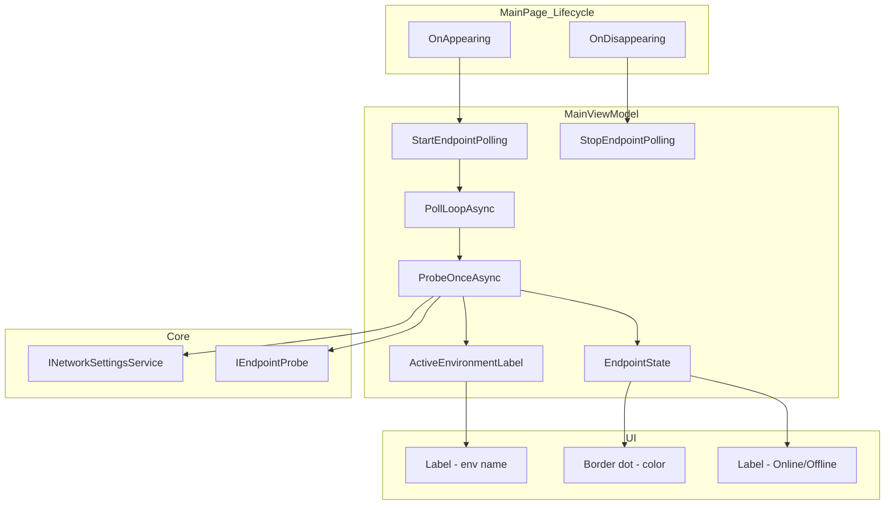

# Plan — Endpoint Availability Indicator on MainPage

## Summary

Add a passive, auto-refreshing availability indicator at the top of MainPage showing the active environment name (nickname/IP:port) and its TCP reachability status (dot + label), polled every 60 seconds via the existing `IEndpointProbe`.

---

## 1. XAML — Where to Insert the Indicator

**Location**: Inside the header `Grid` (`Grid.Row="0"`), within the left `VerticalStackLayout` (the one containing "HL7Tester" title, subtitle, and FHIR badge), **after the FHIR badge `Border`**.

**Rationale**:
- "En haut de page" — the header is the topmost visual zone
- The left stack already uses `Spacing="2"` and has a natural flow (title → subtitle → badge → indicator)
- The header background is `Primary` (purple) / `OffBlack` (dark), so text must use white/gray tones
- Compact: a small `HorizontalStackLayout` (10px dot + 12px label) is sober and unobtrusive
- Only visible in MLLP mode (hidden in FHIR mode via `IsVisible="{Binding IsMllpMode}"`)

**XAML to add** (inside the `<VerticalStackLayout Spacing="2">` after the FHIR badge Border, approximately line 44):

```xml
<!-- Active environment availability indicator (MLLP mode only) -->
<HorizontalStackLayout Spacing="6"
                       Margin="0,6,0,0"
                       IsVisible="{Binding IsMllpMode}">
    <Border WidthRequest="10"
            HeightRequest="10"
            StrokeThickness="0"
            VerticalOptions="Center"
            StrokeShape="RoundRectangle 5"
            BackgroundColor="{Binding EndpointState, Converter={StaticResource EndpointStatusToColorConverter}}" />
    <Label Text="{Binding ActiveEnvironmentLabel}"
           FontSize="12"
           VerticalOptions="Center"
           TextColor="{AppThemeBinding Light={StaticResource White}, Dark={StaticResource Gray200}}" />
    <Label Text="{Binding EndpointStatusText}"
           FontSize="12"
           FontAttributes="Bold"
           VerticalOptions="Center"
           TextColor="{Binding EndpointState, Converter={StaticResource EndpointStatusToColorConverter}}" />
</HorizontalStackLayout>
```

**Also**: Register the converter in `<ContentPage.Resources>` (line 8–11):
```xml
<converters:EndpointStatusToColorConverter x:Key="EndpointStatusToColorConverter" />
```

**Visual result**: `● Staging (192.168.1.10:70) Online` — where `●` is the colored dot (green/red/gray), the environment label is white text, and "Online"/"Offline" is colored bold text.

---

## 2. MainViewModel — New Properties & Polling Logic

### 2a. Inject `IEndpointProbe`

Add to the constructor (alongside existing parameters):
```csharp
private readonly IEndpointProbe _endpointProbe;
```

### 2b. New Properties

```csharp
// ---- Endpoint availability indicator ----

private EndpointTestState _endpointState = EndpointTestState.Unknown;
public EndpointTestState EndpointState
{
    get => _endpointState;
    private set
    {
        if (SetField(ref _endpointState, value))
        {
            OnPropertyChanged(nameof(EndpointStatusText));
        }
    }
}

public string EndpointStatusText => EndpointState switch
{
    EndpointTestState.Testing => "Testing…",
    EndpointTestState.Reachable => "Online",
    EndpointTestState.Unreachable => "Offline",
    _ => "Unknown"
};

private string _activeEnvironmentLabel = string.Empty;
/// <summary>
/// Display label for the active connection: "Nickname (ip:port)" or just "ip:port".
/// </summary>
public string ActiveEnvironmentLabel
{
    get => _activeEnvironmentLabel;
    private set => SetField(ref _activeEnvironmentLabel, value);
}
```

### 2c. Polling Fields

```csharp
private CancellationTokenSource? _pollingCts;
private Task? _pollingTask;
private bool _isProbing; // anti-collision guard
private const int PollingIntervalSeconds = 60;
```

### 2d. Public Methods (called from View)

```csharp
/// <summary>
/// Starts the periodic endpoint probe. Called from OnAppearing.
/// Safe to call multiple times — restarts if already running.
/// </summary>
public void StartEndpointPolling()
{
    StopEndpointPolling(); // ensure single loop
    _pollingCts = new CancellationTokenSource();
    _pollingTask = Task.Run(() => PollLoopAsync(_pollingCts.Token));
}

/// <summary>
/// Stops the periodic endpoint probe. Called from OnDisappearing.
/// </summary>
public void StopEndpointPolling()
{
    _pollingCts?.Cancel();
    _pollingCts?.Dispose();
    _pollingCts = null;
    _pollingTask = null;
}
```

### 2e. Poll Loop Implementation

```csharp
private async Task PollLoopAsync(CancellationToken ct)
{
    try
    {
        // Probe immediately on start, then every 60s
        await ProbeOnceAsync(ct).ConfigureAwait(false);

        using var timer = new PeriodicTimer(TimeSpan.FromSeconds(PollingIntervalSeconds));
        while (await timer.WaitForNextTickAsync(ct).ConfigureAwait(false))
        {
            await ProbeOnceAsync(ct).ConfigureAwait(false);
        }
    }
    catch (OperationCanceledException)
    {
        // Expected on stop — no action needed
    }
}

private async Task ProbeOnceAsync(CancellationToken ct)
{
    // Anti-collision: skip if previous probe still running
    if (_isProbing) return;
    _isProbing = true;

    try
    {
        // Load settings to get current active IP/port
        var settings = await _networkSettingsService.LoadAsync(ct).ConfigureAwait(false);
        var ip = settings.LastIpAddress?.Trim() ?? string.Empty;
        var portStr = settings.LastPort?.Trim() ?? string.Empty;

        // Update the environment label (always, even if probing fails)
        ActiveEnvironmentLabel = BuildDestinationLabel(settings, ip, portStr);

        // No IP configured → Unknown state, skip probe
        if (string.IsNullOrWhiteSpace(ip) || !int.TryParse(portStr, out var port) || port < 1 || port > 65535)
        {
            EndpointState = EndpointTestState.Unknown;
            return;
        }

        EndpointState = EndpointTestState.Testing;

        var result = await _endpointProbe.TestTcpAsync(ip, port, cancellationToken: ct)
                                         .ConfigureAwait(false);

        EndpointState = result.Reachable ? EndpointTestState.Reachable : EndpointTestState.Unreachable;

        _logger.LogDebug("Endpoint indicator probe: {Ip}:{Port} → {State}",
            ip, port, EndpointState);
    }
    catch (OperationCanceledException)
    {
        throw; // propagate to loop
    }
    catch (Exception ex)
    {
        EndpointState = EndpointTestState.Unreachable;
        _logger.LogWarning(ex, "Endpoint indicator probe error.");
    }
    finally
    {
        _isProbing = false;
    }
}
```

### 2f. Update `LoadProtocolAsync`

At the end of `LoadProtocolAsync()`, also refresh the label immediately (so the indicator shows correct text even before the first probe completes):

```csharp
// After existing code in LoadProtocolAsync:
var ip = settings.LastIpAddress?.Trim() ?? string.Empty;
var portStr = settings.LastPort?.Trim() ?? string.Empty;
ActiveEnvironmentLabel = BuildDestinationLabel(settings, ip, portStr);
```

### 2g. Thread Safety for UI Updates

MAUI's data binding automatically marshals `PropertyChanged` to the UI thread via `SynchronizationContext`. Since we use `Task.Run` + `ConfigureAwait(false)`, the `PropertyChanged` events raised from the background thread will be dispatched to the UI thread by the binding infrastructure. **No explicit `MainThread.BeginInvokeOnMainThread` is needed** for property setters.

However, to be safe and consistent with MAUI best practices, wrap the property assignments in `ProbeOnceAsync` with:
```csharp
await MainThread.InvokeOnMainThreadAsync(() => { EndpointState = ...; ActiveEnvironmentLabel = ...; });
```

**Decision**: Use `MainThread.InvokeOnMainThreadAsync` for all property updates from the polling loop to guarantee correct behavior on all platforms.

---

## 3. MainPage.xaml.cs — Lifecycle Hooks

### Add to `OnAppearing` (after `LoadProtocolAsync`):

```csharp
// Start endpoint availability polling
vm?.StartEndpointPolling();
```

### Add new `OnDisappearing` override:

```csharp
protected override void OnDisappearing()
{
    base.OnDisappearing();
    var vm = BindingContext as MainViewModel;
    vm?.StopEndpointPolling();
}
```

### Why this pattern is safe:
- `MainViewModel` is **Transient** → each `MainPage` instance gets its own VM
- Shell navigation back to `//MainPage` creates a new page+VM; the old one is GC'd
- `StartEndpointPolling` calls `StopEndpointPolling` first → no duplicate loops even if `OnAppearing` fires multiple times
- `OnDisappearing` guarantees cleanup when navigating away (Inspector, Settings, etc.)

---

## 4. FHIR Mode Behavior

- The indicator is **hidden in FHIR mode** via `IsVisible="{Binding IsMllpMode}"`
- The polling loop still runs (cheap: just reads settings + builds label) but the probe is effectively skipped since `IsMllpMode` controls visibility
- **Alternative**: stop polling entirely in FHIR mode. This is an optimization — the `PeriodicTimer` loop costs negligible resources. For v1, keep it simple and always poll.

---

## 5. Edge Cases

| Scenario | Behavior |
|----------|----------|
| No IP configured | `EndpointState = Unknown`, label shows empty or "No connection", dot is gray |
| IP/port changes while on page | Next 60s tick reads fresh settings → label and probe update automatically |
| IP/port changes while on another page | Polling stopped (OnDisappearing). On return, `OnAppearing` restarts → immediate probe with new values |
| Network unreachable (cable unplugged) | Probe fails with timeout → `Unreachable` (red) |
| App goes to background (mobile) | `OnDisappearing` not called by OS. The `PeriodicTimer` continues. Acceptable for desktop (Windows/macOS). For mobile, could add `App.OnSleeping`/`OnResumeing` in a future iteration. |

---

## 6. Files to Modify

| File | Changes |
|------|---------|
| `V2/HL7Tester/ViewModels/MainViewModel.cs` | Add `IEndpointProbe` field + constructor injection; add `EndpointState`, `EndpointStatusText`, `ActiveEnvironmentLabel` properties; add `_pollingCts`, `_pollingTask`, `_isProbing` fields; add `StartEndpointPolling()`, `StopEndpointPolling()`, `PollLoopAsync()`, `ProbeOnceAsync()` methods; update `LoadProtocolAsync()` to refresh label immediately; add `using HL7Tester.Core;` (already present via existing import) |
| `V2/HL7Tester/MainPage.xaml` | Add `EndpointStatusToColorConverter` to `ContentPage.Resources`; add `HorizontalStackLayout` indicator inside the header left `VerticalStackLayout` after the FHIR badge |
| `V2/HL7Tester/MainPage.xaml.cs` | Call `vm.StartEndpointPolling()` at end of `OnAppearing`; add `OnDisappearing` override calling `vm.StopEndpointPolling()` |
| `V2/HL7Tester/MauiProgram.cs` | **No changes needed** — `IEndpointProbe` is already a singleton, `MainViewModel` is already transient with DI |

---

## 7. Architecture Diagram



---

## 8. Decisions to Validate with User

| # | Question | Recommendation |
|---|----------|----------------|
| 1 | **Polling interval**: Fixed 60s or configurable in settings? | Fixed 60s for v1. Can add to `NetworkSettings` later if demand arises. |
| 2 | **Placement**: Inside the purple header (left stack, below FHIR badge) vs. a separate thin bar between header and content? | Inside header (compact, no layout shift, stays within existing visual zone). |
| 3 | **Latency display**: Show probe latency (e.g. "Online · 12ms") or just "Online"? | Just "Online"/"Offline" for v1 (sober). Latency is a nice-to-have for a future iteration. |
| 4 | **FHIR mode**: Hide indicator entirely in FHIR mode, or probe the FHIR server's base URL host? | Hide in FHIR mode (v1). FHIR probing requires HTTP-level logic, not TCP. |
| 5 | **Indicator text when no connection**: Show "No connection configured" or hide the indicator? | Show "No connection" with gray dot — always visible in MLLP mode for consistency. |
